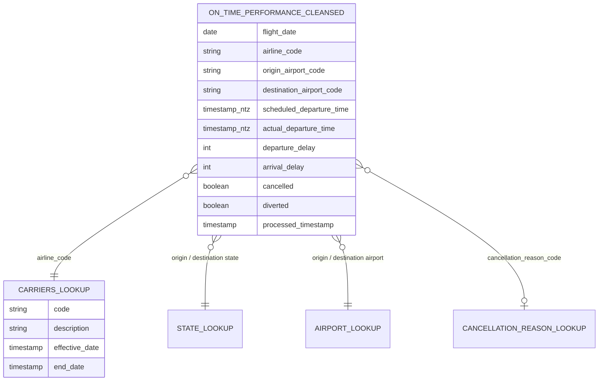
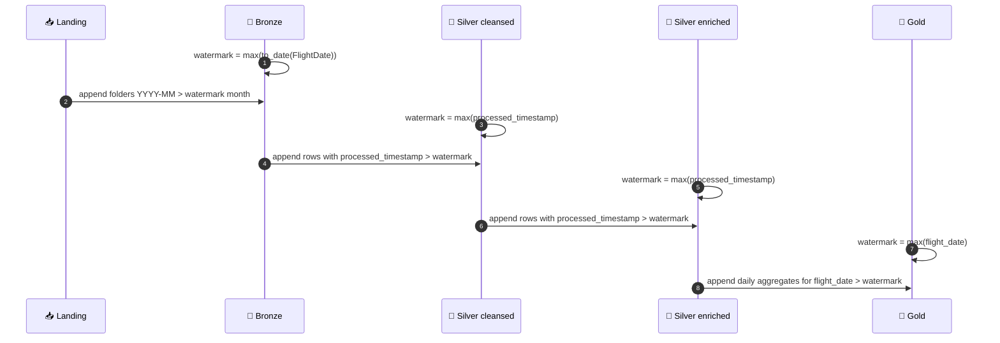
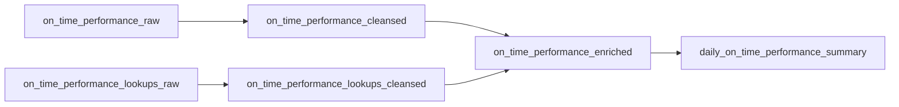

<div align="center">

# ✈️ BTS On-Time Performance Lakehouse

**Bureau of Transportation Statistics – Reporting Carrier On-Time Performance**

An incremental, medallion-architecture data pipeline on **Databricks** that turns raw monthly BTS flight files into clean, enriched and analytics-ready Delta tables.


</div>

---

## 📑 Table of Contents

* [Overview](#-overview)
* [Architecture](#-architecture)
* [Data Model](#-data-model)
* [Project Structure](#-project-structure)
* [Pipeline Layers](#-pipeline-layers)
* [Incremental Loading Strategy](#-incremental-loading-strategy)
* [Shared Modules](#-shared-modules)
* [Getting Started](#-getting-started)
* [Design Decisions](#-design-decisions)
* [Data Source](#-data-source)

---

## 🔭 Overview

The US Bureau of Transportation Statistics (BTS) publishes monthly on-time performance data for every domestic flight operated by large US carriers: scheduled and actual times, delays, cancellations, diversions and delay causes.

This project ingests those monthly CSV extracts together with the BTS reference lookups (carriers, states, airports, cancellation reasons) and processes them through a **Bronze → Silver → Gold** medallion architecture governed by **Unity Catalog**.

| Highlight | Description |
| --- | --- |
| 🏅 Medallion architecture | Landing → Bronze → Silver (cleansed + enriched) → Gold |
| ⚡ Incremental processing | Every layer computes its own watermark from its own target table |
| 🕓 SCD Type 2 lookups | Reference data history is tracked with `effective_date` / `end_date` |
| 🧩 Reusable modules | Time, type and metadata helpers shared across notebooks |
| 🗂️ Unity Catalog | Catalog, schemas and a managed volume for landing files |

---

## 🏛️ Architecture

```mermaid
flowchart LR
    subgraph SRC["🌐 Source"]
        BTS[("BTS TranStats<br/>monthly CSV + lookups")]
    end

    subgraph LND["📥 00_landing"]
        VOL["Volume: data_sources<br/>on_time_performance/YYYY-MM/<br/>lookups/*.csv"]
    end

    subgraph BRZ["🥉 01_bronze"]
        B1["on_time_performance_raw"]
        B2["carriers_lookup<br/>state_lookup<br/>airport_lookup<br/>cancellation_reason_lookup"]
    end

    subgraph SLV["🥈 02_silver"]
        S1["on_time_performance_cleansed"]
        S2["*_lookup (SCD Type 2)"]
        S3["on_time_performance_enriched"]
    end

    subgraph GLD["🥇 03_gold"]
        G1["daily_on_time_performance_summary"]
    end

    BTS --> VOL
    VOL -- "new months only" --> B1
    VOL -- "full refresh" --> B2
    B1 -- "typing & timestamps" --> S1
    B2 -- "MERGE" --> S2
    S1 --> S3
    S2 -- "broadcast joins" --> S3
    S3 -- "daily aggregation" --> G1
    G1 --> BI["📊 BI / Analytics"]

    style BRZ fill:#cd7f32,stroke:#8b5a2b,color:#fff
    style SLV fill:#c0c0c0,stroke:#808080,color:#000
    style GLD fill:#ffd700,stroke:#b8860b,color:#000
    style LND fill:#e8f4fd,stroke:#0078d4,color:#000
    style SRC fill:#f5f5f5,stroke:#999,color:#000
```



<details>
<summary>📝 Plain-text version of the diagram</summary>

```
  BTS TranStats
       │
       ▼
 ┌──────────────┐    ┌───────────────┐    ┌──────────────────────────┐    ┌────────────────────────┐
 │  00_landing  │───▶│   01_bronze   │───▶│        02_silver         │───▶│        03_gold         │
 │  (Volume)    │    │  raw strings  │    │ cleansed ─▶ enriched     │    │ daily summary (KPIs)   │
 │  CSV files   │    │  + lookups    │    │ lookups (SCD Type 2) ─┘  │    │                        │
 └──────────────┘    └───────────────┘    └──────────────────────────┘    └────────────────────────┘
```

</details>

---

## 🗃️ Data Model

All objects live in the Unity Catalog catalog **`bts_ontime`**.

| Schema | Object | Type | Description |
| --- | --- | --- | --- |
| `00_landing` | `data_sources` | Volume | Raw CSV drops: `on_time_performance/YYYY-MM/` and `lookups/` |
| `01_bronze` | `on_time_performance_raw` | Delta table | Selected source columns as strings + `processed_timestamp` |
| `01_bronze` | `carriers_lookup`, `state_lookup`, `airport_lookup`, `cancellation_reason_lookup` | Delta tables | Lookup CSVs loaded as-is |
| `02_silver` | `on_time_performance_cleansed` | Delta table | Typed, renamed columns with full flight timestamps |
| `02_silver` | `*_lookup` | Delta tables | SCD Type 2 lookups (`code`, `description`, `effective_date`, `end_date`) |
| `02_silver` | `on_time_performance_enriched` | Delta table | Cleansed facts with codes replaced by descriptive names |
| `03_gold` | `daily_on_time_performance_summary` | Delta table | One row per `flight_date` with flight, delay and distance KPIs |



---

## 📁 Project Structure

```
bts_ontime_performance/
├── 📄 README.md
├── 🧩 modules/                                   # Reusable Python modules
│   ├── initialization/
│   │   └── lookup_initializer.py                 # initialize_lookup_table()
│   ├── transformations/
│   │   └── metadata.py                           # add_processed_timestamp()
│   └── utils/
│       ├── time_utils.py                         # at_hhmm, plus_minutes, arrival_near, nearest_to
│       └── type_utils.py                         # to_int, to_bool
├── 🔄 transformations/notebooks/                 # Incremental (recurring) pipeline
│   ├── 01_bronze/
│   │   ├── on_time_performance_raw
│   │   └── on_time_performance_lookups_raw
│   ├── 02_silver/
│   │   ├── on_time_performance_cleansed
│   │   ├── on_time_performance_lookups_cleansed
│   │   └── on_time_performance_enriched
│   └── 03_gold/
│       └── daily_on_time_performance_summary
├── 🛠️ one_off/                                   # Run once
│   ├── creating_catalog_schema_volume            # Catalog, schemas & volume setup
│   └── initial_load/notebooks/                   # Initial full load, mirrors transformations/
│       ├── 01_bronze/ ...
│       ├── 02_silver/ ...
│       └── 03_gold/ ...
└── 🔍 ad_hoc/
    └── on_time_performance_eda                   # Exploratory data analysis
```

---

## 🏅 Pipeline Layers

### 📥 Landing – `00_landing`

Raw files are dropped into the Unity Catalog volume `/Volumes/bts_ontime/00_landing/data_sources/`:

* `on_time_performance/YYYY-MM/` – one folder per month of flight data
* `lookups/` – `L_UNIQUE_CARRIERS.csv`, `L_STATE_ABR_AVIATION.csv`, `L_AIRPORT.csv`, `L_CANCELLATION.csv`

### 🥉 Bronze – `01_bronze`

| Notebook | What it does |
| --- | --- |
| `on_time_performance_raw` | Detects month folders newer than the latest `FlightDate` already in bronze, reads 31 selected columns as strings, adds `processed_timestamp` and appends. |
| `on_time_performance_lookups_raw` | Loads the four lookup CSVs with `initialize_lookup_table()` (overwrite). |

### 🥈 Silver – `02_silver`

| Notebook | What it does |
| --- | --- |
| `on_time_performance_cleansed` | Renames to snake_case, casts types, maps `DayOfWeek` to a day name, strips the state suffix from city names and builds full `TIMESTAMP_NTZ` values for departures, arrivals and wheels off/on. |
| `on_time_performance_lookups_cleansed` | Maintains SCD Type 2 lookups with Delta `MERGE`: closes changed active rows, inserts new versions and new keys. |
| `on_time_performance_enriched` | Left-joins the cleansed facts with the broadcast lookups (states and airports joined twice, for origin and destination). Each code column is replaced in place by its description. |

### 🥇 Gold – `03_gold`

| Notebook | What it does |
| --- | --- |
| `daily_on_time_performance_summary` | Aggregates enriched flights per `flight_date`. |

Metrics produced per day:

* ✈️ **Volume** – `total_flights`, `total_cancellations`, `total_diversions`
* ⏱️ **Delays** – min / max / avg of `departure_delay` and `arrival_delay`
* 🛫 **Air time & distance** – min / max / avg / total `air_time`, avg / total `distance`
* 🔎 **Delay causes** – totals for carrier, weather, NAS, security and late-aircraft delays

---

## ⚡ Incremental Loading Strategy

Each layer derives its **own watermark from its own target table**; no state is passed between notebooks, so every step can be re-run safely and independently.



| Layer | Watermark column | Filter on source | Write mode |
| --- | --- | --- | --- |
| Bronze | `max(to_date(FlightDate))` | Landing folders with a later `YYYY-MM` | append |
| Silver cleansed | `max(processed_timestamp)` | `processed_timestamp > watermark` | append |
| Silver enriched | `max(processed_timestamp)` | `processed_timestamp > watermark` | append |
| Gold | `max(flight_date)` | `flight_date > watermark` | append |

> 💡 If no new data is found, each notebook prints a message and skips the write.

---

## 🧩 Shared Modules

Notebooks add the project root to `sys.path` and import from `modules/`.

| Module | Function | Purpose |
| --- | --- | --- |
| `utils/time_utils.py` | `at_hhmm(date, hhmm)` | Combines a date with an `HHmm` string into `TIMESTAMP_NTZ` (`2400` rolls over to the next day) |
| | `plus_minutes(ts, minutes)` | Adds a minutes column to a timestamp |
| | `arrival_near(dep_ts, hhmm)` | Places an arrival time within `[-6h, +18h]` of departure |
| | `nearest_to(ref_ts, hhmm)` | Places a clock time on the day within 12h of a reference |
| `utils/type_utils.py` | `to_int(col)` | String → double → int (handles values like `'125.00'` under ANSI mode) |
| | `to_bool(col)` | `'0.00'` / `'1.00'` → `false` / `true` |
| `transformations/metadata.py` | `add_processed_timestamp(df)` | Adds a `processed_timestamp` audit column |
| `initialization/lookup_initializer.py` | `initialize_lookup_table(file, table)` | Loads a lookup CSV from the volume into bronze |

> ⚠️ Imported `.py` modules get `spark` via `from databricks.sdk.runtime import spark`, because notebook globals are not visible inside modules.

---

## 🚀 Getting Started

1. **Create the Unity Catalog objects**
   Run `one_off/creating_catalog_schema_volume` to create the `bts_ontime` catalog, the `00_landing`, `01_bronze`, `02_silver`, `03_gold` schemas and the `data_sources` volume.

2. **Upload source files**
   * Monthly flight CSVs → `/Volumes/bts_ontime/00_landing/data_sources/on_time_performance/YYYY-MM/`
   * Lookup CSVs → `/Volumes/bts_ontime/00_landing/data_sources/lookups/`

3. **Run the initial load**
   Execute the notebooks in `one_off/initial_load/notebooks/` in order: `01_bronze` → `02_silver` → `03_gold`.

4. **Run the incremental pipeline**
   For each new month, upload the folder and run `transformations/notebooks/` in the order below. This is a natural fit for a multi-task Lakeflow Job.



> 🖥️ All notebooks are written in PySpark and run on serverless compute.

---

## 🧠 Design Decisions

* **Local timestamps** – flight times are stored as `TIMESTAMP_NTZ` in local airport time, since BTS reports times without time zones.
* **Departure** – actual = scheduled + `DepDelay`, falling back to `FlightDate` + `DepTime`. This puts flights delayed past midnight on the correct date.
* **Arrival** – scheduled = `CRSArrTime` placed within `[-6h, +18h]` of scheduled departure; actual = scheduled + `ArrDelay`, falling back to `ArrTime` near the actual departure (for example, diverted flights).
* **Wheels off / on** – placed on the day within 12 hours of actual departure / actual arrival.
* **Types** – delay, taxi, air time, distance and delay-cause columns are `INT`; `cancelled` and `diverted` are `BOOLEAN`.
* **Enrichment** – lookups are broadcast and descriptive names replace code columns in their original position.
* **Lookup history** – SCD Type 2, so changes to reference descriptions are preserved over time.

---

## 🌐 Data Source

* **Publisher:** U.S. Department of Transportation – Bureau of Transportation Statistics
* **Dataset:** [Reporting Carrier On-Time Performance (1987–present)](https://www.transtats.bts.gov/Fields.asp?gnoyr_VQ=FGJ)
* **Lookups:** `L_UNIQUE_CARRIERS`, `L_STATE_ABR_AVIATION`, `L_AIRPORT`, `L_CANCELLATION`

---

<div align="center">

Built with ❤️ on Databricks

</div>
